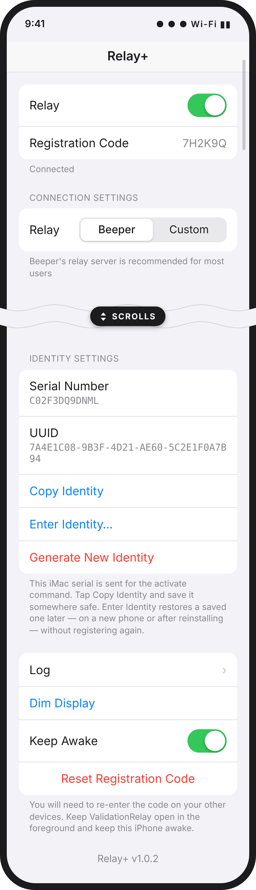

# ValidationRelay-plus

Originaly a fork of [JJTech's ValidationRelay](https://github.com/JJTech0130/ValidationRelay),
based on his v1.8 release. This app is based off his work. This fork keeps a
relay iPhone registering after Apple's October 2026 change and stays compatible
with the current OpenBubbles release, with safeguards so the identity it uses
doesn't get lost.

It also includes the reliability fixes from
[Xare123's pull request #17](https://github.com/JJTech0130/ValidationRelay/pull/17),
which hasn't been merged into the original yet. His commits are applied
on top of v1.8 under his name.

  
   
  <em>The app's one screen (UI mockup; the code, serial and UUID are examples).</em>

## What's different from the original

- **Current OpenBubbles compatibility.** Updated for the 11/1/2026 OpenBubbles
  release.
- **Report as Mac.** Apple's October 2026 change means a relay has to present a
  Mac identity to register. New installs have this on and register as a Mac. An
  existing registration keeps working with it off, so updating doesn't disturb
  one that already works.
- **The identity stays the same.** It's created once and kept. Apple
  activates each serial number only once, so if the identity is lost or
  changed, registrations made with it stop renewing and must be done again.
- **Backup and restore.** **Copy Identity** copies the serial number and UUID
  so you can store them somewhere safe. **Enter Identity** restores them, for
  example after reinstalling the app.
- **Confirmations.** Generating a new identity and resetting the registration
  code both ask first. Resetting the code also creates a new identity, because
  a new registration needs one.
- **Reliability fixes** (Xare123, PR #17). Validation errors and timeouts
  are handled instead of crashing the app, reconnects are more dependable,
  low-level memory leaks are fixed, and the registration secret is kept in
  the Keychain and left out of the log. Custom relay addresses must start
  with `wss://`.
- **Automatic builds.** GitHub Actions builds `ValidationRelay.tipa` on every
  push.

## Install

Requires an iPhone with [TrollStore](https://ios.cfw.guide/installing-trollstore/).

1. Download **[ValidationRelay.tipa](https://github.com/mkitchingh/ValidationRelay-plus/releases/latest/download/ValidationRelay.tipa)**
   (always the latest release). Do this on the iPhone, or AirDrop the file to it.
2. Open the `.tipa` with TrollStore and tap **Install**. It installs over the
   original app and keeps its settings and registration code. On the home
   screen it shows as **Relay+**.
3. Open the app, tap **Copy Identity**, and save it somewhere safe.

All releases are on the [Releases page](https://github.com/mkitchingh/ValidationRelay-plus/releases).

To build it yourself on a Mac with Xcode, install `ldid` (`brew install ldid`)
and run `./build.sh`.

## Identity

Apple's October 2026 change means a relay has to present a **Mac** identity to
register. The app generates and stores one, and keeps it.

**Report as Mac** controls whether that identity is reported:

- **New installs** have it **on** and register as a Mac. Nothing to set up.
- **Existing registrations** have it **off**, so updating doesn't disturb a
  registration that already works. Leave it off while it's working.
- If you need to register again from scratch, turn it on and tap **Reset
  Registration Code**.

Apple activates each serial only once, so tap **Copy Identity** and keep the
serial and UUID somewhere safe.

Buttons under **Identity settings**:

- **Copy Identity** — copies the serial and UUID. Save them; this is your backup.
- **Enter Identity** — restores a saved identity, for example after reinstalling
  or moving to a new phone, so you don't have to register again.
- **Generate New Identity** — makes a fresh one. You'll have to register again,
  because Apple activates each serial only once.

## Related

[registration-relay-selfhost](https://github.com/mkitchingh/registration-relay-selfhost) — a self-hosted, drop-in replacement for Beeper's registration relay. Run your own instead of depending on Beeper's.
